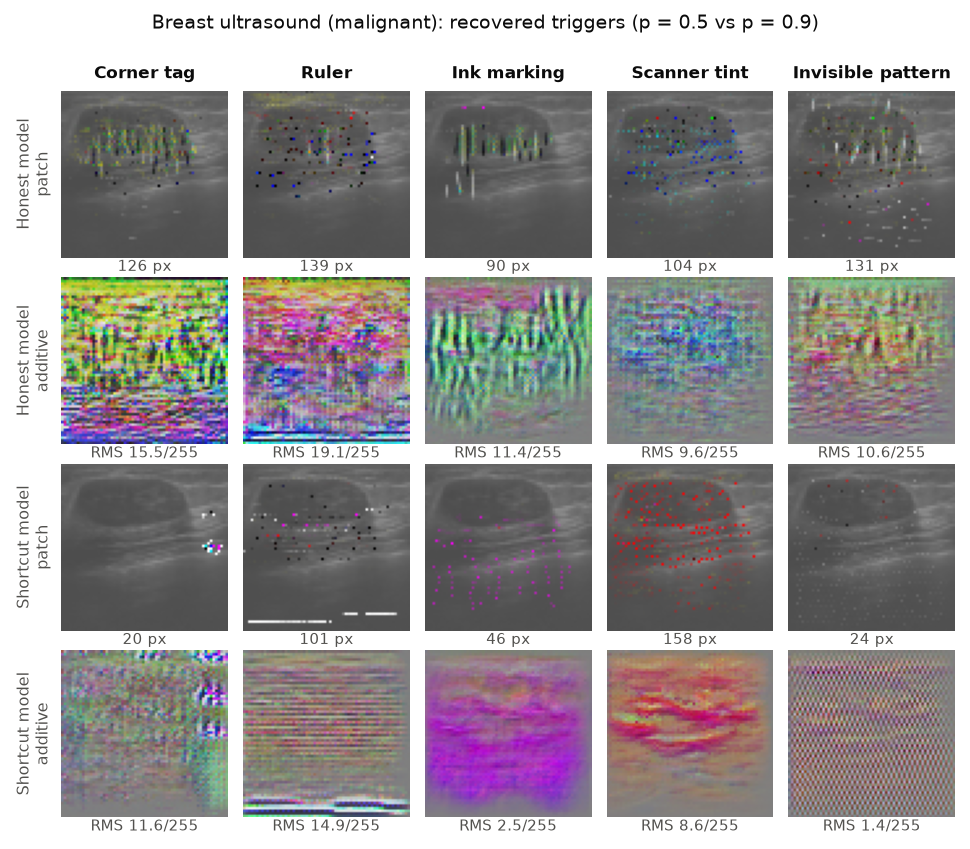

# Hans Hunter

**Catching medical image classifiers that cheat, without knowing how they cheat.**

Medical AI models often learn *shortcuts*: a hospital's corner marker, a ruler, a scanner's colour cast, anything that happens to accompany the disease in the training data. The model's test score rewards a shortcut rather than revealing it. Hans Hunter audits a trained model by asking it one question: *what is the cheapest single edit that makes healthy scans look diseased to you?* On an honest model, that edit has to look like disease. On a cheating model it is small, and it shows you the shortcut.

- 📄 **Technical report:** [docs/hans-hunter.pdf](docs/hans-hunter.pdf) ([HTML](https://ps12007.github.io/hans-hunter/paper.html))
- 🧪 **Interactive demo:** [ps12007.github.io/hans-hunter](https://ps12007.github.io/hans-hunter/). Two chest X-ray models run in your browser. Add the hospital marker and watch one of them panic, or apply the trigger the audit recovered.

The name comes from *Clever Hans*, the horse that seemed to do arithmetic but was reading its trainer's body language.



## What we did

1. **Built a benchmark of 210 models with known shortcuts.** We used three MedMNIST tasks (skin lesions, pediatric chest X-ray, breast ultrasound) and five synthetic artifacts (corner tag, ruler, ink marking, colour tint, and a ±3/255 pattern invisible to people). Each artifact was tied to the disease with strength *p* from 0.5 (unrelated) to 1.0 (always present with disease), with two seeds per setting.
2. **Audited every model blind.** For each model we search for the cheapest universal patch, additive pattern or colour change that flips 80% of healthy images to "disease" (in the spirit of Neural Cleanse). The auditor is never told the artifact.
   We then check whether the recovered trigger still works when pasted onto images from an unrelated dataset (the *context test*).
3. **Found the affected images** by turning the trigger into a direction in feature space.
4. **Repaired the models** with trigger scrubbing (fine-tuning with the recovered trigger) and group-balanced reweighting.
5. **Audited the real datasets** with the same tools.

## Key results

| Finding | Number |
|---|---|
| Shortcut reliance switches on at | *p* ≈ 0.8 |
| Healthy children flagged with pneumonia once the marker is added, at *p* = 0.9 (new-hospital AUC still 0.94, honest model 0.97) | **40%** |
| Detecting shortcut models from the cheapest patch size (AUROC; breast / skin / chest X-ray) | **0.95** / 0.77 / 0.64 |
| Detecting them with the context test: does the trigger still work on unrelated images? (skin / chest X-ray) | **0.97** / **0.93** |
| Finding which images carry the shortcut, *p* = 0.9 (within-class AUROC; skin / breast) | 0.91 / 0.97 |
| Trigger scrubbing on the invisible pattern, breast (new-hospital AUC; oracle 0.87) | 0.72 → **0.87** |
| False alarms from the invisible pattern after scrubbing | 42% → **0%** |
| Reweighting with human-confirmed groups, breast (oracle 0.88) | 0.71 → 0.84 |
| BreastMNIST test images with a near-identical copy in its training set | **16.7%** (2 with the opposite label) |

## Results to read carefully

These are reported plainly in the paper. They matter as much as the wins.

- **AUC hides shortcuts.** A model can keep a near-perfect AUC at a new hospital while flagging many healthy patients, because the shortcut shifts every prediction rather than reordering them.
- **Cheap-to-flip does not mean cheating.** Honest chest X-ray models are flipped by 20–30 pixels of lung opacity, as cheaply as shortcut models. The *context test* separates them: paste the trigger onto images from an unrelated dataset. A shortcut key still works there, while a disease imitation does not. It fails on breast ultrasound, where honest triggers are adversarial noise that works anywhere, so cost and context complement each other and neither works with one threshold for every dataset.
- **The model's own score is a strong baseline.** For finding shortcut-carrying images, our trigger direction beats ranking by model score by only 0.02–0.04 AUROC.
- **Scrubbing works for global shortcuts (the invisible pattern, the tint) and not for local markers.** Automatically inferred groups are too noisy for reweighting. Human confirmation is the step that makes the repair work.
- **Nothing fixes *p* = 1.** If every diseased training image has the marker and no healthy one does, the data cannot distinguish the two. The audit flags these models most clearly; the fix is new data.
- **Approaches that failed:** a sparse-autoencoder feature audit (the artifact was mixed with disease features), contrast and bimodality statistics, projection with inferred groups, and augmentation during the trigger search (EOT).

## Run it

```bash
pip install -r requirements.txt     # plus a CUDA build of PyTorch for speed
python -m hans.download             # 131 MB of MedMNIST v2 into data/
sh run_all.sh                       # trains the 210 models, then every audit; resumable
python experiments/export_demo.py   # rebuilds docs/demo/
```

On one laptop GPU the whole pipeline takes a few hours. Each script skips work it has already saved, so it can be stopped and restarted. `results/` holds the JSON output of every run, so the figures can be regenerated with `python experiments/figures.py` without retraining.

| Path | Contents |
|---|---|
| `hans/data.py` | loading, the five artifacts, label-correlated assignment |
| `hans/model.py` | the ResNet, training (bf16, channels-last), evaluation |
| `hans/forensics.py` | trigger search: patch, additive, colour |
| `hans/sae.py` | the sparse-autoencoder audit (negative result) |
| `experiments/phase.py` | the 210-model benchmark |
| `experiments/forensics.py` | blind audit of every model |
| `experiments/context.py` | the context test |
| `experiments/ground.py` | finding shortcut-carrying images |
| `experiments/fix.py`, `reweight.py` | repairs |
| `experiments/saliency.py` | Grad-CAM baseline |
| `experiments/real_audit.py` | duplicate check and audit of clean models on the real data |
| `docs/` | demo site, report, figures |

## Limitations

The artifacts are synthetic and cleanly stamped. Images are 64×64 and the models are small. There are two seeds per condition. The real-data audit runs on MedMNIST's preprocessed images, which may already have removed the borders and burned-in text through which real shortcuts usually enter. This is a research tool, not a medical device.

## Related work

Zech et al. 2018 (hospital shortcuts in pneumonia CNNs) · DeGrave et al. 2021 (COVID-19 detectors choose shortcuts) · Winkler et al. 2019 (skin markings and melanoma CNNs) · Geirhos et al. 2020 (shortcut learning) · Lapuschkin et al. 2019 (Clever Hans predictors) · Wang et al. 2019 (Neural Cleanse) · Selvaraju et al. 2017 (Grad-CAM) · Sagawa et al. 2020 (group DRO) · Liu et al. 2021 (JTT) · Kirichenko et al. 2023 (DFR) · Oakden-Rayner et al. 2020 (hidden stratification) · Yang et al. 2023 (MedMNIST v2).

Data: MedMNIST v2, CC BY 4.0. Code: MIT.
